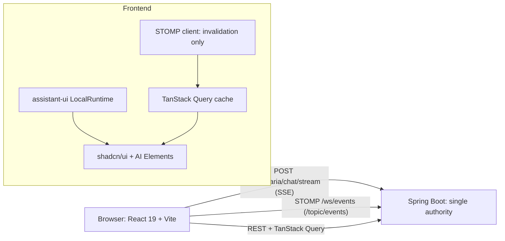

# UI Refresh — Design (Phase 1)

Status: approved for spec review
Date: 2026-11-24
Base: `main` @ `4bf39e98`

## 1. Outcome

The dashboard becomes a flat, enterprise operator console built on shadcn/ui and AI Elements, with Aria chat running on assistant-ui over the existing SSE turn stream. Phase 1 delivers the new shell, a rebuilt Overview, and a rebuilt Aria page. The backend and its contracts do not change in Phase 1.

Success criteria:

| id | Criterion | Evidence |
|----|-----------|----------|
| S1 | Shell, Overview, and Aria render against the live local stack with no browser console errors | Playwright run + console capture |
| S2 | Aria parity with today's page (conversation list, live tool/thinking activity, final message, stop, slash commands, delete), plus inline approval, waiting-input, and memory-proposal cards that reach the same decision endpoints AriaPanel uses today | Real-stack run with a GATED ask |
| S3 | Stopping a run aborts the SSE request and leaves the conversation consistent | Playwright test + network log |
| S4 | All 12 routes still load inside the new shell; legacy pages keep their behaviour | Route smoke test |
| S5 | Dark and light themes both pass WCAG AA for body text and controls | Contrast measurement on painted elements |
| S6 | No new backend process and no change to Spring endpoints | Process list + `git diff` on backend modules |
| S7 | Initial JS bundle delta is measured and recorded in the PR | `pnpm build` output before/after |

## 2. Scope

| In Phase 1 | Out of Phase 1 |
|------------|----------------|
| shadcn/ui + Tailwind 4 foundation and token mapping | Rebuild of the other 9 pages |
| New shell: sidebar, topbar, theme, connection state, notifications | URL/IA changes |
| Overview page rebuilt | AG-UI protocol |
| Aria page rebuilt on assistant-ui `LocalRuntime` | Token-level streaming |
| Query invalidation wiring for STOMP events | SSE replay / event log |
| Route smoke, approval E2E, pilot screenshot baselines | Mobile layout, native apps |

After Phase 1 is accepted, the remaining pages move in waves of two; the last wave removes legacy CSS. AG-UI and token streaming are Phase 2 and get their own spec.

## 3. Architecture



Ownership rules:

| State | Owner |
|-------|-------|
| Aria conversation messages and run status | assistant-ui runtime |
| Runs, approvals, kanban, agents, reports, knowledge | TanStack Query (server state) |
| Ambient domain events | STOMP client, used only to invalidate Query keys and to raise toasts |
| Theme, sidebar collapse, connection indicator | Local UI state / shadcn provider |

### 3.1 Build configuration

- Tailwind CSS 4 through `@tailwindcss/vite`, alongside the existing React plugin.
- `@/*` path alias in `tsconfig.json`, `tsconfig.app.json`, and `vite.config.ts`.
- `pnpm dlx shadcn@latest init` for `components.json`, theme variables, and `lib/utils`.
- `pnpm add @assistant-ui/react`; thread primitives are added from the assistant-ui registry.
- AI Elements are copied patterns, not a package: they live under `src/components/ai-elements/` and are owned by this repository.
- shadcn components live under `src/components/ui/`.
- No Next.js, no Node runtime, no new process.

### 3.2 Frontend structure

```
src/
  components/
    ui/            shadcn components (CLI-managed, editable)
    ai-elements/   copied AI Elements patterns
    layout/        shell (sidebar, topbar, theme, connection)
  chat/            Aria runtime provider, adapter, custom parts
  api/queryKeys.ts shared Query key registry
  styles/
    tokens.css     Tailwind theme + shadcn variables (dark/light)
    *.css          existing flow CSS, removed per wave
```

## 4. Event contracts

### 4.1 SSE → assistant-ui

A single `ChatModelAdapter` wraps the existing `streamMessage` client. It yields cumulative content and accumulates tool calls outside the loop.

| SSE event | Rendered as | Notes |
|-----------|-------------|-------|
| `thinking` | Reasoning/activity indicator | Payload carries `runId` only, so no text is shown |
| `tool_call` | Tool-call part, keyed by `toolCallId` | Rendered with the AI Elements Tool pattern |
| `tool_result` | Result attached to the same tool call | `ok: false` renders as an error |
| `approval_required` | Tool-call part with the reserved name `__approval`, custom tool UI styled as a Confirmation card | Shows tool name, risk tier, options (`once`/`reject`), expiry; Allow/Deny POST the decision; the original SSE stream stays open |
| `waiting_input` | Tool-call part with the reserved name `__question`, custom tool UI | Question text plus answer action |
| `memory_proposal` | Tool-call part with the reserved name `__memory`, custom tool UI | Subject/fact/value/sensitivity and approve/reject actions |
| `message` | Text part | The backend sends one final `finalOutput` per turn, not deltas |
| `done` | Run completion | Ends the assistant message |
| `error` | Runtime error | Surfaced in the thread with a retry action |

Approval handling is server-driven by design: the UI posts to the existing approval endpoint and keeps consuming the same SSE stream. assistant-ui's `requires-action` approval gate is not used because it would end the adapter run before the backend finishes the turn.

Cancel: `abortSignal` is passed into `streamMessage`; assistant-ui's stop action therefore aborts the fetch and the backend's existing cancellation path is unchanged.

### 4.2 STOMP → Query invalidation

The STOMP client no longer writes content state. Each event maps to Query keys:

| Event family | Invalidates |
|--------------|-------------|
| Run lifecycle and progress events from `EventBroadcastListener` | `runs`, `run(id)`, overview summary |
| Approval requested/decided/expired | `approvals`, decision queue, `run(id)` |
| Kanban created/transitioned/assigning | `kanban`, overview summary |
| Knowledge submitted/approved/retired | `knowledge` |
| Report generated/amended | `reports` |
| Workflow advanced | `workflows` |
| Agent created | `agents` |
| Audit log, housekeeping progress | notifications only |

Reconnect behaviour: on STOMP reconnect, the app refetches the affected active queries. There is no event replay; a missed event between disconnect and reconnect is recovered by refetch, not by cursor.

## 5. Visual system

### 5.1 Tokens

| Purpose | Source | Target variable |
|---------|--------|-----------------|
| Text | `--text`, `--text-dim`, `--text-mute` | `--foreground`, `--muted-foreground` |
| Lines | `--line` | `--border` |
| Accent | `--brand` (dark `#0066B3`, light `#3a64e6`) | `--primary`, `--ring` |
| Status | `--green`, `--amber`, `--red` | Custom `--success`, `--warning`, `--destructive` |
| Radius | `--radius` | `--radius` (target 8px) |
| Scrollbars | `--sb-*` | Kept as-is |
| Surfaces | Existing theme surfaces (audited during implementation) | `--background`, `--card`, `--popover` |

Both themes stay; the existing toggle stays. Type scale targets: body 14px/22, secondary 13px/20, page title 24px/32, KPI 28px/34, line-height 1.5. Spacing follows a 4px grid.

### 5.2 Style rules

- Flat solid surfaces, 1px borders, no gradients, glass blur, glows, or decorative chrome.
- One accent colour; status colours only for status.
- Inline SVG icons with a consistent stroke; no emoji icons.
- Larger body type than today; tighter vertical rhythm; no nested cards.
- Focus states use `--ring`; keyboard order follows DOM order; streaming updates announce through an `aria-live` region.

### 5.3 Shell

- Sidebar: collapsible, grouped as Operate (Overview, Runs, Ops, Crew), Build (Workflows, Knowledge, Memory, Reports), Chat (Aria, Chat), System (Providers, Jobs). URLs are unchanged.
- Topbar: product name, runtime badge (`opencode/HOST`), STOMP connection indicator, theme toggle, notifications, configuration.
- Legacy pages render inside the new shell unchanged until their wave.

### 5.4 Page compositions

Overview:

| Block | Composition |
|-------|-------------|
| KPI row | shadcn Card + existing honesty copy (recorded tokens, runs without usage) |
| Decision queue | AI Elements Confirmation rows, blocking asks only |
| Run activity | AI Elements Task/Trace with tool and subagent steps |
| Kanban summary | shadcn Card/Badge, no drag behaviour change |
| Activity feed | shadcn Item/Table, virtualised only if measured necessary |

Aria:

| Block | Composition |
|-------|-------------|
| Conversation rail | `ConversationSidebar` from the main-chat work, restyled by tokens |
| Thread | assistant-ui Thread primitives styled by tokens; Message Scroller behaviour |
| Composer | assistant-ui Composer; slash-command menu retained |
| Activity | tool cards, reasoning indicator; live progress panel retained |
| Decisions | `__approval`, `__question`, `__memory` custom tool UIs |
| Run controls | stop, delete conversation, new conversation |

## 6. Migration

CSS cascade layers protect the legacy pages:

```
@layer theme, base, components, utilities;
@import "tailwindcss";
```

Tailwind output is layered; legacy flow CSS stays unlayered and therefore keeps precedence until a page is migrated. Preflight is included from the start and its effect is checked by the 12-route smoke test.

Wave plan:

| Wave | Pages | Exit condition |
|------|-------|----------------|
| 1 | Shell, Overview, Aria | S1–S7 |
| 2 | Runs, Ops | Both pages on shadcn; their flow CSS deleted |
| 3 | Crew, Providers | Same |
| 4 | Workflows, Jobs | Same |
| 5 | Knowledge, Memory, Reports | Same |
| 6 | Chat, Settings | Same |
| 7 | Cleanup | No unreferenced legacy CSS or variables; full suites green |

Each wave: replace page internals, delete the page's legacy CSS, add screenshot baseline, run route smoke. A page is not migrated while another session owns it; ownership is recorded in the PR.

Rollback: every wave is a separate, revertible change. Legacy CSS is deleted in the same change that migrates its page, so reverting the change restores both the page and its styles. The shell wave ships with the legacy pages still on their own CSS, so it can be reverted without touching them.

## 7. Testing and acceptance

| Layer | Tests |
|-------|-------|
| Unit (Vitest) | Adapter event mapping (fixtures for thinking, tool call/result, approval, waiting, memory, error, done); cumulative yield; abort; Query invalidation map |
| Component | Approval card posts the decision and renders the decided state; decision queue reflects the same approval; theme toggle |
| E2E (Playwright) | 12-route smoke; Aria send and stop; inline Allow/Deny; sidebar collapse; theme; screenshot baselines for shell, Overview, Aria |
| Real stack | GATED run creates an ask; Allow writes the file, Deny does not; decision queue and run status update; STOMP reconnect refetches |
| Build | `pnpm test`, `pnpm build`, `npx playwright test`; backend suites unchanged |

Acceptance is the S1–S7 table in section 1. Any criterion not exercised is reported as NOT VERIFIED in the PR.

## 8. Known limitations

- No token-level streaming: `message` arrives once at the end of the turn. Aria shows activity and then the full answer. Token deltas arrive with Phase 2 (AG-UI).
- No SSE replay: a dropped stream is recovered by refetching the conversation and run; events between disconnect and refetch are not reconstructed.
- Legacy pages look different from the new shell until their wave.
- Custom tool-call parts (`__approval`, `__question`, `__memory`) depend on assistant-ui message-part contracts; the version is pinned and covered by adapter tests.
- The Aria page transcript does not persist decision receipts. A decision is permanent in the approval/memory records and visible in the decision queue; the in-thread card resets on reload.
- Attachment input stays in the Aria panel during Phase 1; the rebuilt Aria page is text-only, as it is today.
- assistant-ui's built-in approval gate is intentionally not used; the server-driven flow above is the contract.

## 9. Preconditions

- MainChatPage ownership is resolved before Wave 1: either the main-chat expansion work is merged, or its owner freezes the file for this wave. The refresh does not edit another session's worktree.
- `#130` (aria-glass / Qwen live) styles and files are untouched; glass tokens remain in the codebase for that surface.
- shadcn, AI Elements, and assistant-ui versions are pinned in the implementation plan.

## 10. Out of scope

- Backend endpoint changes, AG-UI, SSE replay, token streaming.
- New product features or permission semantics.
- URL or deep-link changes.
- Mobile/native layouts.
- Removal of legacy CSS before its page wave.
